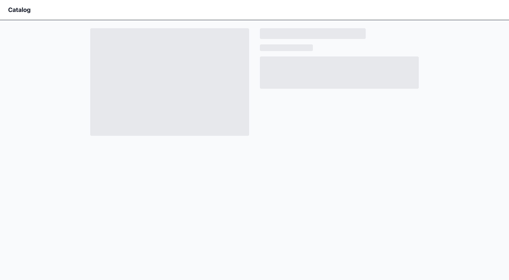
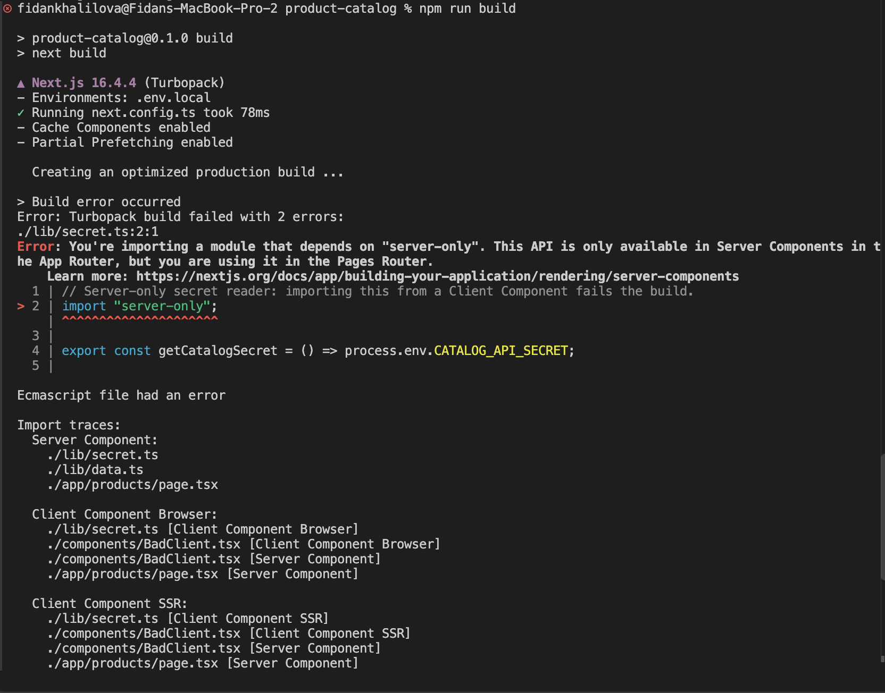
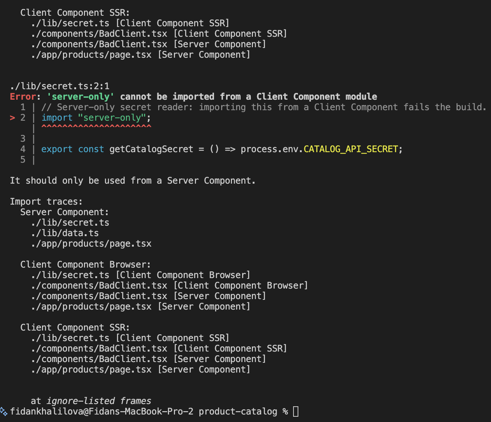

# Server-Rendered Product Catalog (Next.js 15 App Router)

Run: `npm i && npm run build && npm run start` (served locally with `next start`, not deployed to Vercel).

## Server vs Client components
| Component | Type | Why |
|---|---|---|
| `products/page.tsx`, `[id]/page.tsx` | Server | async data fetching, no interactivity |
| `Reviews`, `RelatedProducts`, `ProductCard`, `Stars`, `Skeletons` | Server | pure rendering; average rating computed server-side |
| `CategoryFilter` | Client (leaf) | `onChange` handler |
| `AddToCart` | Client (leaf) | `useState` + click handlers |
| `ReviewForm` | Client (leaf) | `useOptimistic` + transition |
| `error.tsx`, `WebVitals` | Client (leaf) | error boundaries and web-vitals hooks require it |

Props crossing the boundary are serializable (strings, string arrays) plus one Server Action reference.
Plain functions and class instances can't be serialized into the RSC payload, so they can't cross.

## No-JS proof

Note: streamed (non-prerendered) products need JS to reveal Suspense content, so the proof uses the
prerendered `/products/1`. Dynamic products still render shell + image without JS.

## server-only boundary
Importing `@/lib/secret` from a Client Component fails the build:

## Caching
`getReviews` uses `unstable_cache` (tag `reviews`). `submitReview` calls `revalidateTag("reviews")` and
`revalidatePath`. Removing either leaves stale reviews/ratings after posting.

## Timings (production build, local)
| Page | TTFB | Total |
|---|---|---|
| `/products/3` without streaming | 2.1s | 2.1s |
| `/products/3` with streaming | 0.07s | 2.17s |
| `/products/1` (prerendered) | 0.04s | 2.16s |

## Bonus
- `generateStaticParams`: popular products (1, 2, 4) prerendered; compared above.
- PPR: <static shell vs streamed holes, or "not available on stable Next 15">.
- `useOptimistic` on review submit; `error.tsx` recovers from `/products/fail`.